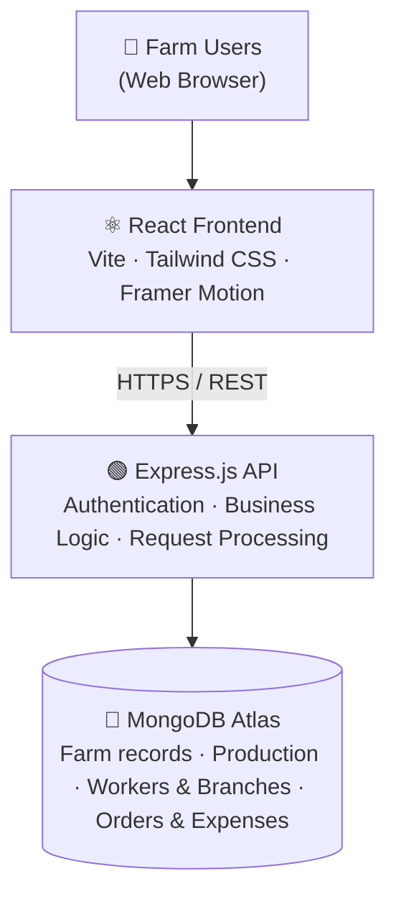

<div align="center">

# 🌱 KhamarBari

### Industrial-Scale Farm Management System

**One platform for livestock, poultry, fisheries, workforce, production, finance, and multi-branch operations.**


[**🚀 Live Demo**](https://khamar-bari-v2-rho.vercel.app/) · [**⚙️ API Server**](https://khamar-bari-backend.vercel.app/) · [**💻 Source Code**](https://github.com/AhsanCS64/KhamarBari_v2)

</div>

---

## 📑 Table of Contents

- [Why KhamarBari?](#-why-khamarbari)
- [Screenshots](#-screenshots)
- [Features](#-features)
- [Tech Stack](#-tech-stack)
- [Architecture](#-architecture)
- [Getting Started](#-getting-started)
- [API Overview](#-api-overview)
- [Deployment](#-deployment)
- [Roadmap](#-roadmap)
- [Contributing](#-contributing)
- [Author](#-author)

---

## 🌾 Why KhamarBari?

Many farms in Bangladesh still run on paper ledgers, spreadsheets, and memory. The result is fragmented records, manual calculations, and little visibility into what is being produced, spent, and earned.

**KhamarBari** replaces that patchwork with a single, API-driven web platform. Farm operators can manage every part of a diversified operation, from the barn to the pond to the books, and across multiple branches, from one place.

| Before | With KhamarBari |
|---|---|
| Scattered notebooks and spreadsheets | One centralized system |
| Manual totals and tallies | Structured, queryable records |
| No cross-branch visibility | Branch-level and farm-wide views |
| Guesswork in planning | Historical data to support forecasting |

---

## 📸 Screenshots

<!-- Add screenshots to /docs/screenshots and update the paths below. -->

| Dashboard | Production Records |
|:---:|:---:|
|  |  |

| Livestock | Fisheries |
|:---:|:---:|
|  |  |

---

## ✨ Features

| Module | What it does |
|---|---|
| 🐄 **Livestock** | Animal records and populations, farm-level inventory, and milk output tracking |
| 🐓 **Poultry** | Flock records, daily egg production, and poultry inventory |
| 🐟 **Fisheries** | Pond information, fish farming operations, and fisheries production records |
| 📊 **Production Monitoring** | Daily logging of milk, eggs, and other outputs with full historical records |
| 👷 **Workforce** | Worker profiles and farm-level employee administration |
| 💰 **Finance & Orders** | Bills, expenses, orders, and transaction records for spending visibility |
| 🏢 **Multi-Branch** | Branch-specific records with centralized administration |
| 📈 **Forecasting** | Planning support built on historical production data |

All modules share one authenticated backend and one database, so records stay consistent across the whole system.

---

## 🛠 Tech Stack

| Layer | Technology |
|---|---|
| **Frontend** | React, Vite, Tailwind CSS, Framer Motion |
| **Backend** | Node.js, Express.js |
| **Database** | MongoDB Atlas |
| **Auth** | JWT-based authentication |
| **API** | REST over HTTPS |
| **Hosting** | Vercel (frontend and backend) |
| **Tooling** | JavaScript, Git & GitHub |

---

## 🏗 Architecture

KhamarBari uses a client–server architecture with a separately deployed frontend and backend.



**Design highlights**

- **Separation of concerns:** independent React and Express applications.
- **Modular design:** each agricultural domain is its own functional module.
- **Stateless API:** token-based auth keeps the backend easy to scale and deploy.
- **Managed cloud data:** MongoDB Atlas handles persistence and availability.

---

## 🚀 Getting Started

### Prerequisites

- [Node.js](https://nodejs.org/) (LTS recommended) and npm
- [Git](https://git-scm.com/)
- A [MongoDB Atlas](https://www.mongodb.com/atlas) account or any compatible MongoDB instance

### 1. Clone the repository

```bash
git clone https://github.com/AhsanCS64/KhamarBari_v2.git
cd KhamarBari_v2
```

### 2. Install dependencies

Run this in **each** application directory (frontend and backend):

```bash
npm install
```

### 3. Configure environment variables

**Backend** (`.env`)

```env
MONGODB_URI=your_mongodb_connection_string
JWT_SECRET=your_secure_random_secret
PORT=5000
```

**Frontend** (`.env`)

```env
VITE_API_URL=http://localhost:5000
```

> ⚠️ Never commit `.env` files. Use a long, random value for `JWT_SECRET`.

### 4. Run the development servers

In two terminals:

```bash
# Terminal 1: backend
cd <backend-directory>
npm run dev
```

```bash
# Terminal 2: frontend
cd <frontend-directory>
npm run dev
```

If the backend has no `dev` script, use the start command in its `package.json`.

### 5. Open the app

Visit **http://localhost:5173** (the default Vite URL).

---

## 🔌 API Overview

All backend routes are served under the `/api` prefix.

| Method | Endpoint | Description |
|---|---|---|
| `POST` | `/api/auth/login` | Authenticate a user and receive a token |

Example against the deployed API:

```bash
curl -X POST https://khamar-bari-backend.vercel.app/api/auth/login \
  -H "Content-Type: application/json" \
  -d '{"email": "you@example.com", "password": "your_password"}'
```

<!-- Add the remaining module endpoints (livestock, poultry, fisheries, production, workers, orders, branches) here as the API stabilizes. -->

---

## ☁️ Deployment

| Service | Platform | Link |
|---|---|---|
| Frontend | Vercel | [khamar-bari-v2-rho.vercel.app](https://khamar-bari-v2-rho.vercel.app/) |
| Backend | Vercel | [khamar-bari-backend.vercel.app](https://khamar-bari-backend.vercel.app/) |
| Database | MongoDB Atlas | Managed cloud database |

When deploying, set the same environment variables from the setup step in each Vercel project's settings, and point `VITE_API_URL` at the deployed backend URL.

---

## 🗺 Roadmap

- [x] Livestock, poultry, and fisheries management
- [x] Daily production tracking
- [x] Workforce, orders, and expense management
- [x] Multi-branch support
- [x] Production forecasting foundation
- [ ] AI-powered forecasting using historical farm data
- [ ] Automated inventory alerts and resource monitoring
- [ ] IoT integration (temperature, humidity, water-quality sensors)
- [ ] Advanced financial reporting and profitability analysis
- [ ] Predictive livestock health monitoring
- [ ] Interactive analytics dashboards
- [ ] Automated reporting and data export
- [ ] Mobile application

---

## 🤝 Contributing

Contributions, issues, and feature requests are welcome.

1. Fork the repository
2. Create a feature branch: `git checkout -b feature/your-feature`
3. Commit your changes: `git commit -m "Add your feature"`
4. Push the branch: `git push origin feature/your-feature`
5. Open a Pull Request

---

## 👤 Author

**H. M. Ahsan Habib Kushal**
Computer Science and Engineering, National Institute of Textile Engineering and Research (NITER), University of Dhaka

[](https://github.com/AhsanCS64)
[](https://ahsanhabibkushal.vercel.app/)

---

<div align="center">

**KhamarBari: Bringing Agriculture and Technology Together** 🌱

</div>
